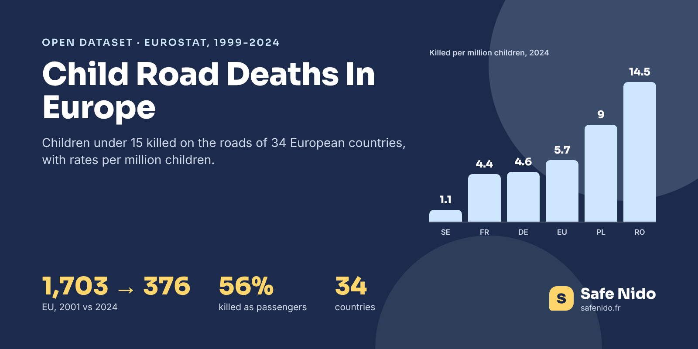

# Child Road Deaths In Europe 1999-2024



[](https://doi.org/10.5281/zenodo.24154221) [](https://www.kaggle.com/datasets/safenido/europe-child-road-deaths) [](https://huggingface.co/datasets/safenido/europe-child-road-deaths) [](https://creativecommons.org/licenses/by/4.0/) [](https://www.safenido.fr/)

**English first, version française plus bas.**

In 2001, **1,703 children under 15** died on the roads of the European Union. In 2024 the number was **376**, a fall of 78%. This dataset gives the yearly count for 34 European countries and the EU, split into passengers, pedestrians and young drivers or riders, next to the number of children living in each country, so that countries of very different sizes can be compared.

The counts come from Eurostat table tran_sf_roadus, fed by the CARE database of the European Commission, and the population from demo_pjangroup. Rates per million children are computed here.

### The Headline Numbers

|  |  |
|---|---|
| Children under 15 killed in the EU, 2001 | 1,703 |
| Children under 15 killed in the EU, 2024 | 376 |
| EU rate, 2024 | 5.7 per million children |
| Share killed as passengers, EU 2024 | 56% |
| Lowest rates, 2024 | Sweden 1.1, Norway 2.2, Austria 3.0 |
| Highest rates, 2024 | Romania 14.5, Estonia 13.6, Finland 10.8 |
| France, Germany, Italy, Spain, 2024 | 4.4, 4.6, 4.0, 4.5 |

More than half of the children killed on European roads are passengers, most of them in cars, which is exactly where a well fitted child seat makes the difference. The gap between countries is wide. A child in Romania was about thirteen times more likely to die on the road in 2024 than a child in Sweden, the country that made rear-facing seats the norm for toddlers decades ago.

### Files

| file | content |
|---|---|
| `data/child_road_deaths_europe_1999_2024.csv` | 863 rows, one per country and year |
| `images/cover.png` | Cover image, 1600 × 800 |

### Columns

**child_road_deaths_europe_1999_2024.csv**

| column | description |
|---|---|
| `country_code` | Eurostat code (EL is Greece, UK the United Kingdom, EU27_2020 the European Union) |
| `country` | Country name |
| `year` | Year |
| `children_killed` | Children under 15 killed, all road users |
| `children_killed_as_passengers` | Killed as passengers of any vehicle |
| `children_killed_as_pedestrians` | Killed as pedestrians |
| `children_killed_as_drivers_or_riders` | Killed as drivers or riders (bicycles, mopeds...) |
| `all_ages_killed` | Road deaths at all ages |
| `population_under_15` | Children under 15 on 1 January |
| `population_total` | Total population on 1 January |
| `children_killed_per_million_children` | children_killed / population_under_15 x 1,000,000 |
| `passengers_per_million_children` | Same for passengers |
| `share_of_all_road_deaths_pct` | Children as a percentage of all road deaths |

### Load It

```python
import pandas as pd

base = "https://raw.githubusercontent.com/safenido/europe-child-road-deaths/main"
df = pd.read_csv(f"{base}/data/child_road_deaths_europe_1999_2024.csv")
df[df.year == 2024].sort_values("children_killed_per_million_children")
```

### How It Was Built

Both Eurostat tables were downloaded through the Eurostat dissemination API in JSON-stat on 12 November 2026 (data updated by Eurostat on 5 November 2026), flattened, and joined on country and year. The population under 15 is the sum of the 0-4, 5-9 and 10-14 age groups. Rates are left empty when the population is missing.

### Checked Against The Source

Germany 2024 (53 children killed) matches the Destatis press release of August 2025. France 2024 (51) is close to the French BAAC count (55, which also covers the overseas departments).

### Read With Care

- **Passengers means passengers of any vehicle**, buses and coaches included. Eurostat does not split children by vehicle.
- **Small countries move a lot** from one year to the next. Luxembourg, Malta or Iceland often record zero.
- **Deaths are counted within 30 days** of the crash. Some countries apply correction coefficients in some years.
- **Country coverage varies by year**, check for empty cells before comparing trends.

### License And Citation

**[CC BY 4.0](https://creativecommons.org/licenses/by/4.0/)**. Use it, share it and adapt it, commercially or not, and credit **Safe Nido** with a link to **[safenido.fr](https://www.safenido.fr/)**, along with the original source below.

```bibtex
@misc{safenido_europe_child_road_deaths_2026,
  title  = {Child Road Deaths In Europe 1999-2024},
  author = {{Safe Nido}},
  year   = {2026},
  doi    = {10.5281/zenodo.24154221},
  url    = {https://github.com/safenido/europe-child-road-deaths},
  note   = {Dataset, version 1.0}
}
```

Source. Eurostat, tran_sf_roadus (CARE database, DG MOVE) and demo_pjangroup, under the Eurostat reuse policy, https://doi.org/10.2908/TRAN_SF_ROADUS

Archived on **[Zenodo](https://doi.org/10.5281/zenodo.24154221)** with a permanent DOI, 10.5281/zenodo.24154221.

Companion datasets, **[France Child Road Casualties 2005-2025](https://github.com/safenido/france-child-road-casualties)** ([Kaggle](https://www.kaggle.com/datasets/safenido/france-child-road-casualties), [Hugging Face](https://huggingface.co/datasets/safenido/france-child-road-casualties)), **[Child Car Seat Crash Test Statistics 2007-2026](https://github.com/safenido/child-car-seat-crash-test-statistics)** ([Kaggle](https://www.kaggle.com/datasets/safenido/child-car-seat-crash-test-statistics), [Hugging Face](https://huggingface.co/datasets/safenido/child-car-seat-crash-test-statistics)). All Safe Nido datasets are listed in **[Child Passenger Safety Datasets](https://github.com/safenido/child-passenger-safety-datasets)**.

Also on **[GitHub](https://github.com/safenido/europe-child-road-deaths)**, **[Kaggle](https://www.kaggle.com/datasets/safenido/europe-child-road-deaths)** with a starter notebook, and **[Hugging Face](https://huggingface.co/datasets/safenido/europe-child-road-deaths)**, ready for the `datasets` library.

### On Safe Nido

The data behind these files is used on [Safe Nido](https://www.safenido.fr/), an independent French guide to child car seats built on twenty years of crash tests.

- [Rear-facing seats and safety](https://www.safenido.fr/guides/siege-auto-dos-a-la-route-plus-sur/)
- [The Swedish Plus Test explained](https://www.safenido.fr/plus-test/)
- [French car seat law](https://www.safenido.fr/reglementation-siege-auto/)

---

## Version Française

### Les Enfants Tués Sur Les Routes D'Europe, 1999-2024

Les chiffres d'Eurostat sur les enfants de moins de 15 ans tués sur la route dans 34 pays et dans l'Union européenne, par passagers, piétons et conducteurs, avec un taux par million d'enfants.

- Dans l'Union, on est passé de 1 703 enfants tués en 2001 à 376 en 2024.
- Plus de la moitié étaient passagers d'un véhicule.
- La France est à 4,4 par million d'enfants, la Suède à 1,1 et la Roumanie à 14,5.

Licence CC BY 4.0, en citant **Safe Nido** et un lien vers **[safenido.fr](https://www.safenido.fr/)**. Retrouvez les guides et les fiches des sièges sur [Safe Nido](https://www.safenido.fr/).
